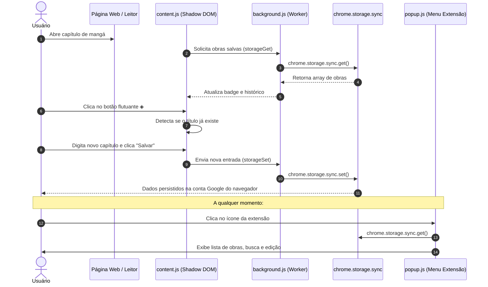

# Chapter Tracker ◈

> Extensão para navegadores (Manifest V3) criada para acompanhar e sincronizar o progresso de leitura e visualização de mangás, animes, séries, livros e outras mídias diretamente em qualquer página web.

---

## 1. Visão Geral do Projeto

O **Chapter Tracker** é uma extensão de produtividade focada em leitores de mangás/manhwas/hqs e espectadores de séries/animes. Ela permite registrar rapidamente em qual capítulo ou episódio você parou, capturar automaticamente o link e o título da página e manter uma lista organizada para continuar sua leitura de onde parou.

---

## 2. O Que Já Temos Implementado (O que Pode ser Aproveitado)

O projeto possui uma base sólida de interface e lógica de injeção que pode ser **100% aproveitada**:

### 2.1. Design System & UI Moderna (Dark Neon)
- **Estética Cyberpunk / Minimalista**: Paleta escura consistente (`#0d0d0f`, `#141418`, `#1c1c22`) com realces em amarelo neon (`#e8ff47`) e acentos de alerta (`#ff5c5c`).
- **Tipografia**: Uso das fontes Google Fonts `Space Mono` (código, metadados e tags) e `Syne` (títulos marcantes).
- **Categorização por Tags**: Sistema de cores e filtros para 5 categorias:
  - `manga` (roxo `#a78bfa`)
  - `anime` (rosa `#f472b6`)
  - `serie` (verde esmeralda `#34d399`)
  - `livro` (azul `#60a5fa`)
  - `outro` (laranja `#fb923c`)

### 2.2. Botão Flutuante In-Page (`content.js` via Shadow DOM)
- Injeta um Floating Action Button (FAB) com ícone `◈` no canto inferior direito de qualquer página web.
- **Isolamento Total via Shadow DOM (`attachShadow({ mode: 'open' })`)**: Nenhum CSS da página externa (leitor de mangá ou streaming) quebra os estilos da extensão, nem a extensão vaza CSS para a página hospedeira.
- **Detecção Inteligente do Título da Página**: Limpa automaticamente sufixos de sites populares (ex: `- Ler Online`, `| Manga Dex`, `– Scan`).
- **Reconhecimento de Obra Já Cadastrada**: Se o usuário já registrou aquela obra anteriormente, o painel reconhece automaticamente, preenche o título, bloqueia edição acidental do nome e solicita apenas o novo capítulo lido.
- **Badge Contador**: Contador flutuante no ícone mostrando a quantidade de obras cadastradas.

### 2.3. Popup da Extensão (`popup.html`, `popup.css`, `popup.js`)
- **Drawer de Criação/Edição**: Painel retrátil e animado para criar ou atualizar registros.
- **Botão de Captura de Aba (`btnCapture`)**: Captura com um clique a URL ativa e o título limpo da aba atual via `chrome.tabs.query`.
- **Filtro de Busca em Tempo Real**: Barra de pesquisa rápida que filtra por nome da obra, número do capítulo ou endereço de URL.
- **Cards de Entradas Interativos**:
  - Indicador de categoria colorido.
  - Link direto para abrir a URL em nova aba (`chrome.tabs.create`).
  - Botão de edição direta (`✎`).
  - Botão de exclusão (`✕`).
  - Data de última atualização formatada em português.
- **Feedback Visual (Toast Notifications)**: Avisos visuais flutuantes temporários de sucesso ou erro.

### 2.4. Service Worker Background (`background.js`)
- Ponte de comunicação via `chrome.runtime.onMessage` para operações de leitura e escrita solicitadas pelo `content.js`.

---

## 3. Como Funciona Atualmente (Fluxo Operacional)



---

## 4. Diagnóstico Técnico & Limitações da Abordagem Atual

Embora o protótipo funcione visualmente bem, existem três gargalos técnicos críticos que impedem a continuidade suave sem ajustes:

### 4.1. Limitação Crítica do `chrome.storage.sync`
1. **Estouro de Cota (8KB por item)**:
   - No código atual, todas as obras são salvas dentro de uma única chave: `chapter_tracker_entries`.
   - O limite do Google Chrome para um único item em `storage.sync` é de **8.192 bytes (8 KB)**.
   - Ao salvar entre 20 a 50 obras com URLs longas, timestamps e títulos, a extensão **para de salvar silenciosamente ou estoura erro de cota**.
2. **Não é Cross-Browser de Verdade**:
   - `chrome.storage.sync` funciona apenas se o usuário estiver logado com uma conta Google no Chrome.
   - **Não sincroniza** entre navegadores diferentes (ex: Chrome no PC do trabalho, Firefox ou Edge no notebook pessoal, Brave no celular).

### 4.2. Inconsistência na Criação vs Edição entre `content.js` e `popup.js`
- No `popup.js`, ao editar uma obra existente, ele localiza o ID e atualiza o item no array.
- No `content.js`, ao detectar uma obra existente, ele faz um `entries.unshift(newEntry)` com um novo UUID gerado. Isso cria múltiplos cards da mesma obra na lista com capítulos diferentes, em vez de atualizar o capítulo atual ou manter um histórico interno da obra.

### 4.3. Assets Faltantes
- O `manifest.json` declara ícones em `icons/icon16.png`, `icons/icon32.png`, `icons/icon48.png`, `icons/icon128.png`, mas a pasta `icons/` ainda não existe no repositório.

---

## 5. Arquitetura de Sincronização Local e Nuvem (Cross-Browser)

Para que o usuário possa usar a extensão em **qualquer navegador** (Chrome, Firefox, Edge, Brave, Opera, Arc) e ter sua leitura sincronizada em tempo real ou sob demanda, a solução recomendada é a arquitetura **Local-First (Offline-First)** com camada de sincronização em nuvem.

### 5.1. Visão Geral da Arquitetura Local-First

```mermaid
graph TD
    subgraph Navegador [Qualquer Navegador (Chrome, Firefox, Edge, Brave)]
        UI[UI: Popup / Floating Action Button]
        LocalDB[(Armazenamento Local: chrome.storage.local ou IndexedDB)]
        SyncEngine[Mecanismo de Sincronização / Sync Manager]
        UI <-->|Leitura e Escrita Imediatas (Sem Latência)| LocalDB
        LocalDB <-->|Verifica Pendências| SyncEngine
    end

    subgraph Nuvem [Serviço em Nuvem Gratuito]
        Auth[Autenticação de Usuário]
        CloudDB[(Banco de Dados em Nuvem: Supabase / Firebase)]
        SyncEngine <-->|Sincronização Bidirecional (HTTPS / WSS)| CloudDB
        SyncEngine <-->|Token JWT| Auth
    end
```

### 5.2. Como Funciona a Camada Local (`chrome.storage.local`)
1. **Sem limite de 8KB**: O `chrome.storage.local` suporta até 10 MB por padrão (e ilimitado com a permissão `"unlimitedStorage"`).
2. **Funcionamento 100% Offline**: Toda adição, remoção ou avanço de capítulo é gravada instantaneamente no disco local. O usuário nunca espera requisições de rede para ler ou atualizar sua página.
3. **Fila de Sincronização**: Cada entrada possui campos de controle de sincronismo:
   - `updatedAt`: Carimbo de data/hora (milissegundos) da última alteração.
   - `syncStatus`: `'synced'` ou `'pending'`.
   - `deleted`: Flag booleana (`true`/`false`) para exclusão lógica (*soft delete*), garantindo que exclusões feitas offline se propaguem para a nuvem.

### 5.3. Opções Recomendadas de Nuvem para Sincronização Universal

| Opção | Prós | Contras | Recomendação |
| :--- | :--- | :--- | :--- |
| **Supabase (PostgreSQL + REST)** | • Gratuito (até 500MB e 50k usuários)<br>• Autenticação fácil (Email/Senha, Google, Magic Link)<br>• API REST simples via `fetch` nativo (sem libs pesadas)<br>• Suporta sincronização em tempo real | Exige criar um projeto no console do Supabase | **★ Melhor Escolha (Mais moderna e flexível)** |
| **Firebase Firestore** | • Muito popular<br>• SDK bem documentado | SDK oficial adiciona peso ao pacote da extensão se não for usado via REST | Boa alternativa |
| **Cloudflare Workers + D1 (SQLite)** | • Extremamente leve<br>• Grátis e latência ultra baixa | Exige deploy de script serverless próprio | Excelente para desenvolvedores experientes |
| **Sync por Chave / Gist / Drive** | • Não requer servidor próprio<br>• Pode usar GitHub Gist secreto ou Google Drive | Depende de configuração manual de tokens pelo usuário | Ótimo para uso pessoal avançado |

---

## 6. Modelo de Dados Sugerido (Schema v2)

Para suportar histórico de leitura, controle de status e sincronização sem conflito entre múltiplos navegadores:

```typescript
interface TrackerEntry {
  id: string;               // UUID v4 único (gerado no cliente)
  userId?: string;          // ID do usuário autenticado na nuvem
  name: string;             // Nome normalizado da obra (ex: "One Piece")
  chapter: string;          // Capítulo ou episódio atual (ex: "Cap. 1110")
  url: string;              // URL direta do capítulo atual
  tag: 'manga' | 'anime' | 'serie' | 'livro' | 'outro';
  coverUrl?: string;        // Opcional: imagem de capa da obra
  notes?: string;           // Opcional: notas pessoais do leitor
  status?: 'reading' | 'completed' | 'on_hold' | 'dropped';

  // Campos de controle de sincronismo e integridade
  createdAt: number;        // Timestamp Epoch ms
  updatedAt: number;        // Timestamp Epoch ms (usado para Last-Write-Wins)
  deleted?: boolean;        // Soft delete para propagar remoções
  syncStatus?: 'synced' | 'pending';
}
```

---

## 7. Estratégia de Resolução de Conflitos (Last-Write-Wins)

Quando você atualiza um capítulo no computador e depois abre outro navegador:
1. **Pull (Baixar alterações)**:
   - A extensão consulta a nuvem buscando registros onde `updatedAt > ultimo_sync_local`.
   - Se um registro remoto for mais recente que o local, ele sobrescreve o local.
2. **Push (Enviar alterações locais)**:
   - Se você leu um capítulo offline, o registro local terá `syncStatus = 'pending'`.
   - Assim que a conexão for restabelecida, a extensão envia essas alterações para a nuvem.
3. **Exclusões (*Soft Delete*)**:
   - Quando você deleta uma obra, a extensão marca `deleted: true` e atualiza `updatedAt`.
   - A nuvem recebe a marcação de deletado e propaga para todos os outros navegadores.

---

## 8. Estrutura de Arquivos Atual

```text
.
├── background.js       # Service worker em segundo plano
├── content.js          # Botão flutuante injetado nas páginas (Shadow DOM)
├── manifest.json       # Configurações da extensão (Manifest V3)
├── popup.html          # Interface do menu popup da extensão
├── popup.css           # Estilos e tema dark cyberpunk do popup
├── popup.js            # Lógica de CRUD, busca e captura de abas
├── package.json        # Dependências do projeto
└── README.md           # Documentação arquitetural do projeto
```

---

## 9. Próximos Passos Recomendados para o Projeto

1. **[Fase 1] Correções Imediatas & Estabilidade**:
   - [ ] Gerar os ícones `icons/icon16.png`, `icons/icon32.png`, `icons/icon48.png`, `icons/icon128.png`.
   - [ ] Migrar a persistência imediata de `chrome.storage.sync` para `chrome.storage.local`.
   - [ ] Corrigir no `content.js` a lógica ao salvar obra já existente (atualizar o capítulo e URL em vez de inserir novo item duplicado).

2. **[Fase 2] Módulo de Autenticação e Nuvem**:
   - [ ] Adicionar tela de Login / Registro ou "Chave de Sincronização" no popup.
   - [ ] Criar serviço `sync-service.js` integrando com **Supabase** (usando a API REST nativa do Supabase com `fetch`).
   - [ ] Implementar rotina de sincronização periódica (via `chrome.alarms` a cada 5 ou 15 minutos e ao abrir o navegador).

3. **[Fase 3] Melhorias de Usabilidade**:
   - [ ] Botão de "Avançar Capítulo (+1)" direto no card ou no botão flutuante.
   - [ ] Histórico de capítulos lidos por obra.
   - [ ] Opção de Exportar e Importar Backup em arquivo `.json`.

---

## 10. Como Testar a Extensão Localmente Hoje

1. Abra o navegador baseado em Chromium (Google Chrome, Brave, Microsoft Edge, Opera).
2. Acesse `chrome://extensions/` (ou `edge://extensions/`).
3. Ative a chave **"Modo do desenvolvedor"** no canto superior direito.
4. Clique no botão **"Carregar sem compactação"** (*Load unpacked*).
5. Selecione a pasta deste projeto (`Yekun Dreaw - Extenção`).
6. Abra qualquer site de leitura de mangás ou streaming para ver o botão flutuante `◈` no canto inferior da tela!
