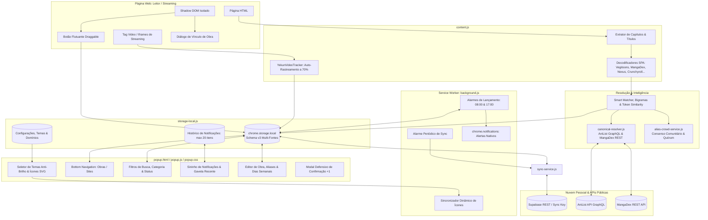

# Yekun Dream ◈

> **Extensão para navegadores (Manifest V3)** criada para acompanhar, unificar e sincronizar seu progresso de leitura e visualização de mangás, manhwas, animes, webtoons, séries e livros diretamente em qualquer página web.  
> Desenvolvido por **Sentsuy** (*Sentsuy Corp*).

[](https://developer.chrome.com/docs/extensions/mv3/intro/)
[](#1-visão-geral)
[](#6-suíte-de-testes-automatizada)
[](#8-autor--licença)

---

## 1. Visão Geral

O **Yekun Dream** (versão 1.2.0) é uma extensão de produtividade focada em entusiastas de leitura e streaming. Diferente de soluções convencionais que criam registros duplicados a cada site visitado, o Yekun Dream conta com uma **arquitetura de obras multi-fontes**: você pode acompanhar a mesma obra em múltiplos leitores ou scans (como MangaDex, Neox Scans, Vegitoons, Crunchyroll, AnimesOnline, etc.), mantendo seu progresso consolidado em uma única entrada, com histórico detalhado e sincronização em nuvem.

O projeto adota a filosofia **Local-First**: funciona 100% offline, com armazenamento local sem limites de cota, zero rastreamento e sem coleta de dados pessoais.

---

## 2. Principais Funcionalidades (v1.2.0)

### 2.1. Arquitetura Multi-Fontes & Histórico de Leitura (Schema v3)
- **Múltiplas Fontes por Obra**: Uma mesma obra (ex.: *Solo Leveling*) agrupa todas as fontes e scans onde você já a leu ou assistiu, registrando qual capítulo você parou em cada uma.
- **Histórico Retrátil**: Gaveta expansível de histórico (até 50 registros por obra) exibindo data/hora, domínio, scan e capítulo/episódio lido.
- **Migração Automática**: Sistema inteligente de auto-migração de esquemas legados (v2 para v3) sem qualquer perda de dados do usuário.

### 2.2. Auto-Rastreamento de Vídeos & Anime Tracker (Regra dos 70%)
- **Detecção Automática de Progresso**: O módulo `YekunVideoTracker` monitora elementos `<video>` em tempo real durante a reprodução.
- **Regra dos 70%**: Salva automaticamente o episódio quando o usuário assiste a 70% ou mais da duração total do vídeo.
- **Prevenção de Falsos Positivos**: Exige um tempo mínimo assistido de reprodução real de 120 segundos, prevenindo que saltos manuais ou scrubbing na barra de progresso alterem o histórico indevidamente.
- **Suporte a Iframes & Players Externos**: Configurado com `all_frames: true` e `match_about_blank: true` no Manifesto, permitindo capturar players embutidos de terceiros através de comunicação segura entre frames.
- **Toast Discreto**: Notifica o salvamento automático com um toast in-page não invasivo.
- **Controle Visual**: Opção liga/desliga no painel de configurações (`autoTrackAnime`).

### 2.3. Alertas de Lançamento & Sininho com Histórico Recente
- **Dois Alarmes Diários em Segundo Plano**:
  - Alerta matinal às **08:00** (`alarm_release_morning_0800`).
  - Alerta vespertino às **17:00** (`alarm_release_evening_1700`).
- **Trava Estrita Anti-Hiato e Anti-Cancelamento**: Obras em hiato (`hiato`), canceladas (`cancelado`), dropadas (`dropado`) ou concluídas (`concluido`) **nunca** disparam notificações, mesmo que possuam dias marcados na semana.
- **Agendamento Híbrido Semanal (Opção 3)**:
  - Seletor manual de dias da semana `[Dom] [Seg] [Ter] [Qua] [Qui] [Sex] [Sáb]` no formulário da obra.
  - Inferência automática do dia de lançamento através da API GraphQL do AniList (`nextAiringEpisode.airingAt`).
  - Badges visuais de dias nos cards das obras (`📅 Seg, Qui`).
- **Sininho de Notificações (`#btnNotifications`)**:
  - Indicador de não lidas (`#notifUnreadDot`) no cabeçalho do popup.
  - Gaveta deslizante com a listagem dos lançamentos recentes, período (manhã/tarde), data, hora e link direto.
  - Limite estrito de no máximo **20 itens** no armazenamento para zero impacto de memória.
  - Botão **Limpar** para resetar o histórico.
- **Ajustes Globais**: Toggles independentes para ativar/desativar alertas gerais, matinais e vespertinos.

### 2.4. Ação Rápida de Incremento Seguro (+1 com Guards)
- **Comparação Semântica de Capítulos**: Ao clicar no botão `(+)`, a extensão verifica o capítulo/episódio detectado na aba ativa contra o capítulo salvo.
- **Guards de Proteção**:
  - Se o link da aba for maior: avança diretamente.
  - Se for igual ou menor, ou se a aba pertencer a outra obra/página de índice: exibe o modal defensivo `showConfirmActionModal` antes de alterar o progresso, evitando avanços acidentais.

### 2.5. Pipelines Especializados para Streaming & Animes
- **Crunchyroll**:
  - Extração inteligente que isola o nome oficial da série e o título do episódio atual.
  - Formatação elegante e padronizada `Temp 01 - Ep 01` (substituindo identificadores técnicos brutos como `s01e01`).
- **AnimesOnline (animesonlinecc.to)**:
  - Tratamento específico para rotas `/episodio/...`, extraindo limpo o nome e número do episódio sem ruídos de SEO.
- **Isolamento de Escopos**: Regras de animes/séries não conflitam com a extração de mangás/manhwas.

### 2.6. Resolução Canônica & Catálogo Colaborativo de Aliases
- **Canonical Public Resolver (`canonical-resolver.js`)**: Integração assíncrona, leve e com timeout de segurança (2500ms) com as APIs públicas do **AniList** (GraphQL) e **MangaDex** (REST) para reconhecer automaticamente títulos oficiais em múltiplos idiomas (Romaji, Inglês, Português e sinônimos).
- **Crowdsourced Alias Consensus Engine (`alias-crowd-service.js`)**: Mecanismo de catálogo colaborativo de títulos com:
  - Validação de quórum (mínimo de 2 confirmações independentes para verificação automática).
  - Trava de integridade 1-para-1 contra conflitos (impede que um apelido seja associado a duas obras diferentes).
  - Sanitização rígida de dados (bloqueia URLs, números de capítulos crus e caracteres perigosos).
- **Smart Work Matching**: Algoritmo híbrido que combina normalização textual, correspondência de aliases e cálculo de similaridade fonética e por bigramas (coeficiente de Dice), sugerindo vínculos com altíssima precisão.

### 2.7. Decodificadores SPA & Scans Especializadas
O extrator inteligente de títulos e capítulos possui suporte dedicado para decodificar aplicações de página única (SPAs) e sistemas com rotas dinâmicas ou ofuscadas:
- **Vegitoons**: Consulta a API interna `/capitulos/:id` para obter título e capítulo reais.
- **MangásTop**: Consulta a rota REST do WordPress `/wp-json/mangastop/v1/leitor/:id`.
- **MangaDex**: Consulta via API `/chapter/:uuid` com recuperação de metadados de relacionamentos.
- **NexusToons**: Descriptografia de rotas com hash `/r/:hash` via algoritmo XOR reverso, além de suporte a rotas `/ler/:slug/:cap` e `/manga/:slug`.

### 2.8. Botão Flutuante In-Page (Content Script & Shadow DOM)
- **Isolamento Total via Shadow DOM**: O botão flutuante (`◈`) e seu painel de atalho utilizam `attachShadow({ mode: 'open' })`, garantindo que estilos da página externa não afetem a extensão e vice-versa.
- **Draggable Floating Action Button**: O botão pode ser livremente arrastado e reposicionado na tela pelo usuário.
- **Detecção & Limpeza Automática de Títulos**: Higieniza automaticamente prefixos ("Ler", "Assistir"), sufixos de scans, slogans de SEO e números de capítulos presentes no `<title>` da página.
- **Vínculo Rápido (1-Click Link)**: Quando uma obra com nome alternativo é aberta, a extensão reconhece o alias e exibe um indicador sutil, ou oferece um diálogo de vínculo direto a uma obra já existente sem criar duplicatas.

### 2.9. Interface Moderna, Temas Anti-Brilho & Ícones Dinâmicos
- **3 Temas Visuais Calibrados (Anti-Brilho)**:
  - 🌙 **Dark (Azul Neon)**: Fundo escuro profundo com detalhes em ciano/azul neon.
  - ☀️ **Light (Branco & Azul)**: Tema diurno de alto contraste, limpo e legível.
  - 🌸 **Pink (Sakura)**: Visual refinado com tons de rosa e bordô.
- **Sincronização Dinâmica do Ícone**: O ícone da extensão no navegador muda dinamicamente de cor e contraste de acordo com o tema selecionado (`icon-dark-*`, `icon-light-*`, `icon-pink-*`).
- **Ícones 100% Vetoriais (SVG inline)**: Design limpo e moderno sem dependências de fontes de ícones externas.
- **Status de Leitura e Publicação**:
  - *Status de Leitura*: `Lendo`, `Concluído`, `Pausado`, `Dropado`, `Planejo`.
  - *Status de Publicação*: `Em Lançamento`, `Finalizada`, `Em Hiato`, `Cancelada`.
- **Bottom Navigation**: Alternância intuitiva entre a aba de **Minhas Obras** e a **Central de Sites / Scans**.
- **Central de Sites Consolidada**: Visão agrupada de todos os sites de leitura utilizados, listando quantas obras estão vinculadas a cada domínio e links diretos para acessá-los.
- **Gavetas em Altura Total (Full-Height Drawers)**: Painéis com rolagem independente que garantem acesso total a todos os campos e botões em qualquer resolução.

### 2.10. Nuvem, Sincronização & Backup
- **Nuvem Pessoal via Supabase REST**: Sincronização universal entre múltiplos navegadores (Chrome, Brave, Edge, Opera, Firefox) usando **Chave de Sincronização pessoal (Sync Key)** e resolução de conflitos *Last-Write-Wins* (LWW) com *soft-delete*.
- **Sincronização Periódica em Segundo Plano**: Rotina agendada no Service Worker via `chrome.alarms` a cada 15 minutos e na inicialização do navegador.
- **Exportação & Importação de Backup (.json)**: Backup completo em arquivo JSON local (com suporte retroativo para importar backups legados v2).

### 2.11. Controle Granular de Domínios & Privacidade Total
- **Barra de Controle de Domínio**: Ative ou desative o botão flutuante no site atual com apenas 1 clique diretamente no topo do popup.
- **Nuvem de Chips (Whitelist & Blacklist)**: Gerenciamento visual e intuitivo de domínios permitidos (*Allowed Domains*) e domínios bloqueados (*Blocked Domains*).
- **Privacidade Total**: Zero coleta de dados pessoais, sem anúncios, sem telemetria e sem intermediários.

---

## 3. Arquitetura do Sistema



---

## 4. Modelo de Dados (Schema v3)

### 4.1. Estrutura de Obras (`WorkV3`)

```typescript
interface WorkV3 {
  id: string;                       // Identificador único (ex: work_uuid)
  name: string;                     // Nome principal da obra (ex: "Solo Leveling")
  aliases?: string[];               // Nomes alternativos / sinônimos em outras línguas
  tag: 'manga' | 'manhwa' | 'manhua' | 'anime' | 'webtoon' | 'serie' | 'livro' | 'outro';
  readingStatus: 'lendo' | 'concluido' | 'pausado' | 'dropado' | 'planejo';
  publicationStatus: 'lancamento' | 'concluido' | 'hiato' | 'cancelado';
  releaseDays?: number[];           // Dias semanais de lançamento: 0=Dom, 1=Seg... 6=Sáb
  mainChapter: string;              // Último capítulo lido (ex: "Cap. 179" ou "Temp 01 - Ep 01")
  lastReadSourceId: string;         // ID da última fonte acessada
  createdAt: number;                // Timestamp Epoch (ms)
  updatedAt: number;                // Timestamp Epoch (ms) para resolução LWW
  deleted: boolean;                 // Soft-delete para sincronização
  syncStatus: 'synced' | 'pending'; // Estado de sincronização com a nuvem

  sources: Array<{                  // Lista de fontes/scans vinculadas
    id: string;                     // ID da fonte (ex: src_uuid)
    siteName: string;               // Nome amigável do site (ex: "MangaDex")
    domain: string;                 // Domínio (ex: "mangadex.org")
    url: string;                    // URL do último capítulo acessado
    chapter: string;                // Capítulo lido nesta fonte específica
    updatedAt: number;              // Timestamp de leitura nesta fonte
  }>;

  history: Array<{                  // Histórico de leituras (últimos 50 acessos)
    id: string;
    timestamp: number;
    siteName: string;
    domain: string;
    chapter: string;
    url: string;
  }>;
}
```

### 4.2. Estrutura de Notificação (`NotificationItemV1`)

```typescript
interface NotificationItemV1 {
  id: string;                       // Identificador único da notificação
  workId: string;                   // ID da obra vinculada
  workName: string;                 // Nome da obra
  type: 'morning' | 'evening';      // Período: matinal (08:00) ou vespertino (17:00)
  url: string;                      // URL de destino ao clicar
  tag: string;                      // Categoria da obra
  timestamp: number;                // Timestamp de envio
  read: boolean;                    // Indicador de leitura
}
```

### 4.3. Configurações Globais (`SettingsV3`)

```typescript
interface SettingsV3 {
  syncKey: string;                          // Chave pessoal de sincronização em nuvem
  supabaseUrl: string;                      // URL da instância Supabase REST
  supabaseKey: string;                      // Chave de acesso Supabase
  autoSyncIntervalMinutes: number;          // Intervalo de sync em segundo plano (padrão: 15 min)
  enableFloatingButton: boolean;            // Botão flutuante ativo nas páginas (padrão: true)
  enableBadgeCount: boolean;                // Contador numérico no botão flutuante (padrão: true)
  enableQuickIncrement: boolean;            // Ação rápida (+1) com guards ativada (padrão: true)
  enableAutoTitleDetection: boolean;        // Preenchimento automático do título (padrão: true)
  enableAutoSync: boolean;                  // Sincronização periódica ligada (padrão: false)
  enableReleaseNotifications: boolean;      // Notificações nos dias de lançamento (padrão: true)
  enableMorningNotification: boolean;        // Alerta matinal às 08:00 (padrão: true)
  enableEveningNotification: boolean;        // Alerta vespertino às 17:00 (padrão: true)
  autoTrackAnime: boolean;                  // Auto-rastreamento de animes ao assistir 70% (padrão: true)
  blockedDomains: string[];                 // Domínios onde a extensão não atua (Blacklist)
  allowedDomains: string[];                 // Domínios com permissão expressa (Whitelist)
  theme: 'dark' | 'light' | 'pink';         // Tema visual ativo (padrão: 'dark')
}
```

---

## 5. Estrutura de Arquivos

```text
.
├── manifest.json              # Manifesto da extensão (Chrome Manifest V3)
├── background.js              # Service Worker (alarmes de sync, lançamento e ícones)
├── content.js                 # Content script: Shadow DOM, botão flutuante e Video Tracker
├── storage-local.js           # Camada de persistência v3, migração, CRUD e notificações
├── canonical-resolver.js      # Resolução de títulos canônicos via AniList e MangaDex
├── alias-crowd-service.js     # Motor comunitário de consenso e quórum para aliases
├── sync-service.js            # Serviço de sincronização em nuvem via Supabase REST
├── popup.html                 # Interface gráfica do popup da extensão
├── popup.css                  # Estilos, temas (Dark, Light, Pink) e layout de gavetas
├── popup.js                   # Lógica da interface, bottom nav, sininho, filtros e editor
├── package.json               # Configurações do projeto e scripts npm
├── docs/                      # Documentação técnica e especificações
│   ├── CHANGELOG.md           # Histórico de alterações e versões
│   └── superpowers/specs/     # Especificações de design e planos de implementação
├── icons/                     # Ícones PNG e SVG em todos os tamanhos e temas
│   ├── icon16.png … icon128.png
│   ├── icon-dark-16.png … icon-dark-128.png
│   ├── icon-light-16.png … icon-light-128.png
│   ├── icon-pink-16.png … icon-pink-128.png
│   └── icon.svg
├── scripts/
│   └── generate-icons.js      # Gerador autônomo de ícones PNG para os temas
├── tests/                     # 46 suítes de testes unitários e de integração
│   ├── run-all-tests.js       # Executor geral de testes
│   └── test-*.js
└── README.md                  # Esta documentação
```

---

## 6. Suíte de Testes Automatizada

O projeto conta com uma suíte de testes robusta cobrindo 100% dos fluxos críticos sem dependências externas complexas.

Para executar todos os testes:

```bash
npm test
```

### Cobertura de Testes (46 Suítes Ativas)

1. **Icon verification**: Validação de dimensões e existência de ícones para todos os temas.
2. **Storage Local unit tests**: Operações CRUD fundamentais e persistência v3.
3. **Storage v3 multi-source tests**: Múltiplas fontes e gaveta de histórico.
4. **Content Script verification**: Injeção e isolamento do Shadow DOM.
5. **Content Script v3 multi-source tests**: Integração de páginas e links de obras.
6. **Chapter Regex & Title Sanitization tests**: Limpeza de sufixos de sites e slogans.
7. **Floating Button Drag & Disable tests**: Arraste e desativação do botão flutuante.
8. **User Demands Regression tests**: Prevenção de regressões em requisitos de usuários.
9. **Allowed Domains Whitelist tests**: Lógica de ativação por lista de permissões.
10. **Domain Chips & Floating Button Activation**: Comportamento dos seletores de chips.
11. **UI/UX Enhancements for Non-Technical Users**: Acessibilidade e usabilidade para leigos.
12. **Theme & Vector SVG icon tests**: Verificação dos temas e vetores SVG inline.
13. **Work Component UI & Typography Cleanup**: Validação de componentes e tipografia.
14. **Single Line Filter & Card Shadow tests**: Barra de filtros e sombras dos cards.
15. **Discreet Site Button & Domain Concealment**: Barra discreta de permissões de domínio.
16. **Real Scans & SPAs Extraction tests**: Testes com Vegitoons, MangaDex e NexusToons.
17. **Popup features & settings verification**: Verificação de painéis do popup.
18. **Popup v3 multi-source tests**: Renderização de fontes e histórico no popup.
19. **Popup Aliases UI & Functional Storage**: Campo de aliases no formulário.
20. **About Panel, Branding & Pix Setup**: Painel sobre, identidade e chave Pix.
21. **Theme Dynamic Sync & Multi-Theme Icons**: Sincronização dinâmica de ícones.
22. **Smart Work Matching & Cross-Site Aliases**: Similaridade por bigramas e tokens.
23. **Canonical Public Resolver (AniList & MangaDex)**: Mapeamento via AniList e MangaDex.
24. **Crowdsourced Alias Consensus & Quorum Engine**: Motor de quórum (>= 2 votos) e consenso.
25. **Collaborative Alias & Storage Integration**: Integração do catálogo com o storage local.
26. **Bottom Nav & Consolidated Sites Hub**: Central de sites e navegação inferior.
27. **Reading & Publication Status tests**: Filtros e persistência de status de leitura/obra.
28. **Series & Movies Divergence Normalization**: Diferenciação de séries e filmes.
29. **Crunchyroll & Streaming Extraction**: Formatação `Temp 01 - Ep 01` e extração da série.
30. **AnimesOnline & Anime Extraction Pipeline**: Pipeline para rotas de episódios e parsing.
31. **Quick Increment Chapter Guards & Comparisons**: Validação semântica e modal defensivo do `(+)`.
32. **Release Day Notifications & Bell History**: Agendamentos, limite de 20 itens e guarda anti-hiato.
33. **Drawer Visibility & Full-Height Layout**: Layout e rolagem completa dos drawers.
34. **Glare-Free Themes & Comfortable Typography**: Calibração anti-brilho e contraste ergonômico.
35. **Save Pre-fill & Cross-Tab Activation Fixes**: Pré-preenchimento confiável e sincronia entre abas.
36. **Verbatim Titles & Dual Aliases Extraction**: Extração literal e normalizada de títulos.
37. **Cloud Sync & background verification**: Serviço de sincronização e alarmes.
38. **Extension Context & Re-injection Safety**: Proteção contra invalidação de contexto.
39. **Anime Video Tracker & Auto-Save (70%)**: Rastreamento de `<video>` e iframes a 70%.
40–46. **Syntax checks**: Análise sintática estrita em todos os arquivos (`storage-local.js`, `sync-service.js`, `canonical-resolver.js`, `alias-crowd-service.js`, `background.js`, `content.js`, `popup.js`).

---

## 7. Como Instalar e Usar no Navegador

1. Abra seu navegador Chromium (**Google Chrome**, **Brave**, **Microsoft Edge**, **Opera**).
2. Acesse `chrome://extensions/` (ou `edge://extensions/`).
3. No canto superior direito, ative a opção **"Modo do desenvolvedor"** (*Developer mode*).
4. Clique no botão **"Carregar sem compactação"** (*Load unpacked*).
5. Selecione a pasta deste projeto (`Yekun Dreaw - Extenção`).
6. A extensão estará instalada! Você verá o ícone do **Yekun Dream** na barra do navegador.
7. Ao acessar sites de mangás ou animes:
   - O botão flutuante `◈` aparecerá no canto inferior direito para salvar com um clique.
   - Em animes/vídeos, ao assistir 70% do episódio, o progresso será salvo automaticamente!

---

## 8. Autor & Licença

- **Autor**: Sentsuy (*Sentsuy Corp*)
- **Site Oficial**: [sentsuy.ddns.net](https://sentsuy.ddns.net/)
- **Natureza**: Software Livre & Gratuito — 100% focado em privacidade, sem fins lucrativos e sem coleta de dados pessoais.
