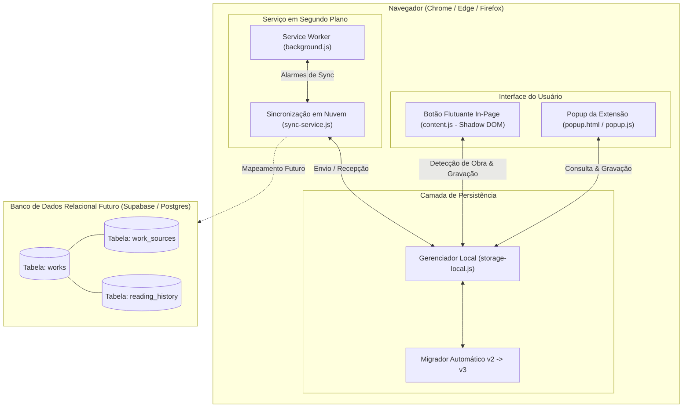

# Chapter Tracker — Especificação Arquitetural: Obras Centralizadas, Múltiplas Fontes e Histórico de Leitura

> **Documento de Especificação Arquitetural**  
> Data: 2026-10-05  
> Status: Em Revisão  
> Escopo: Centralização de Obras, Rastreamento de Múltiplos Sites/Fontes por Obra, Histórico Completo de Leituras, Interface Expansível e Preparação para Banco Relacional.

---

## 1. Visão Geral e Motivação

O **Chapter Tracker** é uma extensão de navegador (Manifest V3) criada para acompanhar o progresso de leitura e visualização de mídias (mangás, manhwas, animes, séries, livros).

### O Problema Resolvido
Leitores de manhuas e mangás frequentemente enfrentam o problema de sites e scans que saem do ar, mudam de domínio ou perdem capítulos. Quando isso acontece, o leitor costuma migrar para outro site ou agregador. Na arquitetura anterior (1 entrada = 1 URL), ao salvar o progresso em um novo site, ou a URL anterior era sobrescrita e perdida, ou uma nova entrada duplicada era criada na lista.

### Objetivos desta Especificação
1. **Centralização na Obra:** A entidade de primeiro nível é a **Obra** (ex: *"Martial Peak"*).
2. **Múltiplos Sites / Fontes por Obra:** Cada obra pode possuir diversas fontes cadastradas (ex: MangaDex, Neox Scans, Reaper Scans), cada uma com sua respectiva URL, último capítulo lido naquele site e data.
3. **Histórico Detalhado de Leituras:** Toda vez que um progresso for salvo em qualquer site, registra-se um evento cronológico (data/hora, nome do site, capítulo lido e link).
4. **Detecção Inteligente In-Page (`content.js`):** Ao ler em qualquer site, o botão flutuante (`◈`) identifica a obra pelo título da página. Se a obra já existir, identifica se o domínio atual já é uma fonte cadastrada (e atualiza) ou se é um novo site (e vincula como nova fonte da mesma obra, sem gerar duplicata).
5. **Interface Moderna no Popup (`popup.html`):** Cards centralizados por obra exibindo o capítulo mais recente, badges com o nome de cada site onde a obra é lida e gaveta retrátil (accordion) com a lista completa de fontes e timeline de histórico.
6. **Migração Transparente e Sem Perda de Dados:** Migração automática do formato `v2` para `v3` na inicialização do `storage-local.js`.
7. **Pronto para Banco de Dados Relacional:** Estrutura de dados pensada para futuro mapeamento com PostgreSQL / Supabase (`works`, `work_sources`, `reading_history`).

---

## 2. Arquitetura do Sistema



---

## 3. Modelo de Dados (Schema v3)

O schema do `chrome.storage.local` passa a utilizar a chave `chapter_tracker_entries_v3`.

### 3.1. Tipos e Interfaces

```typescript
// Categoria da mídia
type MediaTag = 'manga' | 'anime' | 'serie' | 'livro' | 'outro';

// Obra Principal (Entidade Agrupadora)
interface WorkEntry {
  id: string;               // UUID único da obra (ex: "work_9b1deb4d_...")
  name: string;             // Nome limpo da obra (ex: "Martial Peak")
  tag: MediaTag;            // Categoria visual e de filtro
  mainChapter: string;      // Capítulo mais avançado / mais recente global (ex: "Cap. 3850")
  lastReadSourceId: string; // ID da fonte mais recentemente utilizada
  createdAt: number;        // Epoch timestamp (ms) da criação da obra
  updatedAt: number;        // Epoch timestamp (ms) da última modificação
  deleted: boolean;         // Soft delete para sincronismo em nuvem
  syncStatus: 'synced' | 'pending'; // Estado local de sincronização

  // Lista de sites/fontes onde esta obra é lida
  sources: SourceItem[];

  // Linha do tempo de leituras registradas
  history: HistoryLogItem[];
}

// Fonte / Site individual onde a obra é acompanhada
interface SourceItem {
  id: string;               // UUID único da fonte (ex: "src_f81d4fae_...")
  siteName: string;         // Nome legível do site/scan (ex: "MangaDex", "Neox Scans")
  domain: string;           // Domínio normalizado (ex: "mangadex.org")
  url: string;              // URL direta do capítulo ou da página da obra
  chapter: string;          // Último capítulo registrado nesta fonte (ex: "Cap. 3850")
  updatedAt: number;        // Timestamp da última leitura nesta fonte específica
}

// Item do histórico de leituras
interface HistoryLogItem {
  id: string;               // UUID único do evento
  timestamp: number;        // Data e hora do salvamento
  siteName: string;         // Nome do site utilizado
  domain: string;           // Domínio do site
  chapter: string;          // Capítulo registrado no momento
  url: string;              // URL salva
}
```

### 3.2. Estratégia de Migração Automática (v2 ➔ v3)
Ao chamar qualquer método de leitura ou gravação em `storage-local.js`:
1. Verifica se a chave `chapter_tracker_entries_v3` existe.
2. Se não existir, verifica se existe `chapter_tracker_entries_v2`.
3. Para cada entrada antiga em `v2` (que possuía `name`, `chapter`, `url`, `tag`):
   - Cria uma nova `WorkEntry`.
   - Gera um `SourceItem` contendo o `url`, `chapter`, domínio extraído de `url` e `siteName` derivado.
   - Adiciona um primeiro evento correspondente em `history`.
   - Define `mainChapter = entry.chapter` e `lastReadSourceId = source.id`.
4. Salva a nova lista em `chapter_tracker_entries_v3`.
5. Preserva `chapter_tracker_entries_v2` intocada como backup.

---

## 4. Detecção e Interação In-Page (`content.js`)

O script injetado isolado com Shadow DOM gerencia a experiência de leitura diretamente no leitor.

### 4.1. Extração do Nome do Site e Domínio
- Função `extractSiteInfo(url)`:
  - Extrai `hostname` da URL (ex: `neoxscans.net`).
  - Limpa prefixos comuns (`www.`, `m.`, `pt.`).
  - Gera um nome amigável padrão (ex: `neoxscans.net` -> `"Neox Scans"` ou mantém o domínio formatado).
  - Permite ao usuário editar o nome do site se desejar customizar.

### 4.2. Lógica de Reconhecimento e Associação
Ao abrir o painel flutuante (`◈`):
1. Obtém o título limpo da página (`getPageTitle()`).
2. Consulta as obras ativas no `StorageLocal.getWorks()`.
3. Compara o título normalizado com as obras existentes:
   - **Obra Existente Encontrada:**
     - Exibe cabeçalho: `"Obra: [Nome da Obra]"`.
     - Verifica se o domínio atual já existe no array `sources` da obra:
       - **Fonte Já Conhecida:**
         - Exibe status: `"Fonte: [Nome do Site] (Último salvo aqui: [Capítulo])"`.
         - Campo de capítulo pré-preenchido com o valor dessa fonte.
         - Botão de ação: `"Atualizar Progresso"`.
       - **Novo Site para Obra Existente:**
         - Exibe alerta visual: `"＋ Nova fonte detectada para esta obra: [Nome do Site]"`.
         - Campo de capítulo pronto para digitação ou incremento.
         - Botão de ação: `"Vincular Novo Site"`.
   - **Obra Nova:**
     - Exibe cabeçalho: `"Nova Obra"`.
     - Pré-preenche o nome da obra com o título limpo da página e o site com o domínio atual.
     - Botão de ação: `"Salvar Obra"`.
4. Ao clicar em Salvar:
   - Executa `StorageLocal.saveWorkReading({ workId, workName, tag, siteName, domain, url, chapter })`.
   - Se a fonte for nova, adiciona em `sources`. Se já existir, atualiza os dados da fonte.
   - Atualiza `mainChapter` da obra para o capítulo atual.
   - Adiciona uma linha em `history`.
   - Atualiza o badge do botão flutuante e exibe toast de confirmação.

---

## 5. Interface e Gestão no Popup (`popup.html`, `popup.css`, `popup.js`)

### 5.1. Componente de Card da Obra
O card principal da lista exibe:
- **Cabeçalho:** Nome da obra, badge colorido da categoria (`manga`, `anime`, etc.) e tempo desde a última leitura formatado em português.
- **Destaque:** Capítulo mais recente lido globalmente (`mainChapter`).
- **Barra de Badges de Fontes (Chips):**
  - Cada fonte vinculada aparece como um chip clicável com ícone de link externo (ex: `[🌐 MangaDex: Cap. 3850 ↗]`).
  - Clicar no chip abre diretamente aquela fonte específica em nova aba.
- **Ações Rápidas do Card:**
  - Botão `+1`: Incrementa o capítulo da fonte mais recente e atualiza a obra com 1 clique.
  - Botão `↗`: Abre o link da fonte mais recente.
  - Botão de Expansão `▼`: Abre a gaveta retrátil de detalhes (fontes e histórico).
  - Botão `✎`: Abre modal/drawer para editar título e categoria da obra.
  - Botão `✕`: Remove a obra inteira (soft delete).

### 5.2. Gaveta Retrátil de Detalhes (Accordion)
Ao expandir o card:
- **Aba Fontes Cadastradas:**
  - Lista detalhada de cada site onde a obra está salva.
  - Exibe: Nome do site, domínio, capítulo salvo e data da última atualização naquela fonte.
  - Botão de abrir (`↗`), editar capítulo/link daquela fonte (`✎`) e remover aquela fonte (`✕`).
  - Botão `＋ Adicionar Outro Site`: Permite colar um novo link de leitor alternativo para aquela obra.
- **Aba Histórico de Leitura:**
  - Linha do tempo visual exibindo os últimos eventos salvos (data, hora, site e capítulo).
  - Limite configurável (padrão: 50 eventos mais recentes por obra) para evitar consumo desnecessário de memória.

### 5.3. Drawer de Criação e Edição
- Permite cadastrar uma nova obra informando:
  - Nome da Obra.
  - Categoria.
  - Site inicial (Nome, Link e Capítulo).
- Botão de captura automática (`⌖`) que lê a aba ativa e preenche os campos instantaneamente.

---

## 6. Camada de Persistência (`storage-local.js`)

Métodos disponibilizados pela nova versão do `StorageLocal`:

| Método | Descrição |
|---|---|
| `getWorks(includeDeleted = false)` | Retorna todas as obras ativas (com migração automática de dados antigos). |
| `getWorkById(id)` | Retorna uma obra específica com todas as suas fontes e histórico. |
| `saveWorkReading(payload)` | Salva uma leitura: encontra a obra pelo nome ou ID, adiciona/atualiza a fonte correspondente, atualiza `mainChapter` e grava no histórico. |
| `updateWorkDetails(id, { name, tag })` | Atualiza metadados globais da obra. |
| `deleteWork(id)` | Executa soft-delete na obra inteira. |
| `deleteSource(workId, sourceId)` | Remove uma fonte específica de uma obra. |
| `quickIncrementWork(workId)` | Incrementa o capítulo da fonte mais recente da obra e registra no histórico. |
| `exportBackup()` | Exporta JSON completo v3 com todas as obras, fontes e histórico. |
| `importBackup(jsonString)` | Importa e mescla com inteligência backups v2 ou v3. |

---

## 7. Mapeamento Futuro para Banco de Dados Relacional (Supabase / Postgres)

A estrutura v3 reflete diretamente a modelagem SQL normalizada para quando o usuário integrar o banco:

```sql
-- Obras do Usuário
CREATE TABLE works (
    id UUID PRIMARY KEY DEFAULT gen_random_uuid(),
    user_id UUID NOT NULL,
    name TEXT NOT NULL,
    tag TEXT NOT NULL DEFAULT 'manga',
    main_chapter TEXT,
    last_read_source_id UUID,
    created_at TIMESTAMPTZ DEFAULT NOW(),
    updated_at TIMESTAMPTZ DEFAULT NOW(),
    deleted BOOLEAN DEFAULT FALSE
);

-- Fontes / Sites de Leitura por Obra
CREATE TABLE work_sources (
    id UUID PRIMARY KEY DEFAULT gen_random_uuid(),
    work_id UUID REFERENCES works(id) ON DELETE CASCADE,
    site_name TEXT NOT NULL,
    domain TEXT NOT NULL,
    url TEXT NOT NULL,
    chapter TEXT NOT NULL,
    updated_at TIMESTAMPTZ DEFAULT NOW()
);

-- Histórico de Leituras
CREATE TABLE reading_history (
    id UUID PRIMARY KEY DEFAULT gen_random_uuid(),
    work_id UUID REFERENCES works(id) ON DELETE CASCADE,
    site_name TEXT NOT NULL,
    domain TEXT NOT NULL,
    chapter TEXT NOT NULL,
    url TEXT,
    created_at TIMESTAMPTZ DEFAULT NOW()
);
```

---

## 8. Estratégia de Validação e Testes Automatizados

Para garantir integridade completa sem regressão:
1. **Teste de Migração Automática v2 ➔ v3:**
   - Popula dados fictícios no formato antigo `chapter_tracker_entries_v2`.
   - Executa leitura e certifica que `chapter_tracker_entries_v3` foi gerado com `sources` e `history` consistentes.
2. **Teste de Multi-Fontes na Mesma Obra:**
   - Salva "Martial Peak" no Site A (Cap. 100).
   - Salva "Martial Peak" no Site B (Cap. 120).
   - Valida que existe apenas 1 obra cadastrada com 2 fontes distintas e `mainChapter = "Cap. 120"`.
3. **Teste de Atualização de Fonte Existente:**
   - Salva novamente no Site A com Cap. 105.
   - Valida que a fonte do Site A foi atualizada, o Site B permaneceu intacto e o histórico possui os 3 eventos em ordem cronológica.
4. **Teste de Remoção de Fonte e Remoção de Obra:**
   - Valida que remover 1 fonte de uma obra não remove as outras fontes.
   - Valida soft-delete da obra inteira.
5. **Teste de Incremento Rápido (+1):**
   - Valida o avanço no capítulo da fonte ativa.
6. **Teste de Integridade de Backup e Importação:**
   - Exporta e reimporta dados v3 garantindo que nenhuma fonte ou item de histórico seja corrompido.
7. **Verificação de Sintaxe de Todos os Scripts:**
   - Garantir que `storage-local.js`, `content.js`, `popup.js`, `background.js` passem em `node --check`.

---

## 9. Próximos Passos
Após aprovação desta especificação:
1. Conclusão do gate de revisão pelo usuário.
2. Invocação da skill `superpowers:writing-plans` para geração do plano detalhado de implementação passo a passo.
