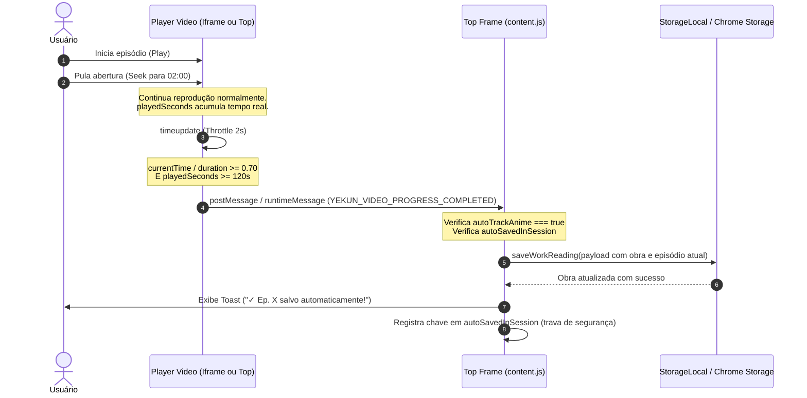

# Especificação Técnica: Auto-Incremento e Rastreamento Automático de Animes (70% do Vídeo)

**Data:** 2026-10-12  
**Status:** Aprovado  
**Autor:** Antigravity & Sentsuy (Sentsuy Corp)  
**Projeto:** Yekun Dream (Extensão Chrome MV3)

---

## 1. Visão Geral e Motivação

Atualmente, o **Yekun Dream** identifica com precisão os títulos e números de episódios/capítulos em páginas web, mas depende do clique manual do usuário no botão flutuante (`◈`) ou no atalho "Salvar" para registrar o progresso de visualização.

Para animes e séries, isso cria um ponto de atrito considerável:
* O usuário geralmente assiste em modo tela cheia (*fullscreen*).
* Ter que sair do fullscreen no fim de cada episódio para clicar em "Salvar" quebra a imersão e atrapalha maratonas (*binge-watching* com reprodução automática).

Esta funcionalidade implementa um subsistema inteligente de **auto-rastreamento de reprodução de vídeo**:
1. Monitora o elemento `<video>` na página principal ou dentro de players embutidos em `<iframe>`.
2. Computa o progresso de reprodução com tolerância total ao hábito de pular a abertura (*opening skip*).
3. Ao atingir **70% do episódio**, aciona automaticamente a rotina de salvamento existente (`StorageLocal.saveWorkReading`) com trava única por sessão.
4. Exibe um **Toast discreto** no canto da tela informando que o episódio foi concluído e salvo.

---

## 2. Requisitos Funcionais

### 2.1. Regra do Gatilho dos 70% (Com Tolerância a Pulo de Abertura)
O salvamento automático do episódio é acionado quando **ambas as seguintes condições forem satisfeitas**:
1. **Posição Relativa do Vídeo**: `video.currentTime / video.duration >= 0.70` (ou seja, a barra de progresso cruzou a marca de 70% da duração total do arquivo).
2. **Tempo Real Assistido Acumulado**: `playedSeconds >= 120` (o vídeo esteve efetivamente em estado de reprodução por pelo menos 2 minutos).
   * *Justificativa:* O usuário costuma pular a abertura (avançando de 0:00 para ~2:00) e assistir o restante da história até os ~17:00 (70%). Nesse fluxo normal, o `playedSeconds` ultrapassa 14 minutos, disparando o salvamento perfeitamente. Contudo, se alguém abrir o player e apenas arrastar a barra para o final para espiar uma cena, o tempo acumulado (< 2 min) impede falsos positivos.
3. **Gatilho de Encerramento (Fallback)**: Caso o evento nativo `ended` do vídeo seja disparado e `playedSeconds >= 60`, o episódio também é computado como concluído (para curtas ou episódios em que o player encerrou antes da marcação).

### 2.2. Filtro Anti-Anúncios (Pré-roll)
* Vídeos com duração total inferior a **60 segundos** (`video.duration < 60`) são ignorados pelo rastreador (evita tratar vinhetas ou anúncios de players como se fossem episódios).

### 2.3. Idempotência e Trava de Disparo Único por Sessão
* Uma chave de rastreamento única `workSessionKey = `${canonicalUrl || location.href}_${chapter}`` é mantida em memória no Top Frame.
* Assim que o salvamento é disparado com sucesso, a chave é registrada em um conjunto (`autoSavedInSession: Set<string>`).
* O mesmo episódio **nunca** é salvo mais de uma vez durante a mesma reprodução, evitando concorrência, loops ou poluição de histórico.
* Quando o usuário navega para o próximo episódio (troca de URL, mudança no `src` do vídeo ou SPA), o rastreador reseta os contadores para o novo episódio.

### 2.4. Suporte a Iframes e Players Cross-Origin
* Como 90% dos sites agregadores de animes utilizam players dentro de `<iframe>` hospedados em domínios externos (ex.: Blogger, StreamWish, FPlayer, etc.), o content script deve ser configurado com `"all_frames": true` no `manifest.json`.
* **Saída rápida (Fast-Exit)**: Se o script for executado em um frame secundário e não encontrar elementos `<video>` após o carregamento inicial, encerra a execução silenciosamente sem criar listeners ou consumir recursos.
* **Comunicação entre Frames**:
  * O iframe do player monitora o `<video>` e calcula o progresso.
  * Ao cruzar a meta de 70%, o iframe despacha uma mensagem padronizada via `window.parent.postMessage` ou `chrome.runtime.sendMessage`:
    ```javascript
    {
      type: 'YEKUN_VIDEO_PROGRESS_COMPLETED',
      ratio: currentRatio,
      playedSeconds: playedSeconds,
      duration: video.duration
    }
    ```
  * O Top Frame (que detém o título do anime, metadados e controle do Storage) intercepta a mensagem e dispara o salvamento.

### 2.5. Feedback Visual (Toast Discreto)
* Ao salvar automaticamente, o Top Frame emite o Toast nativo da extensão no canto da tela:
  > **✓ Ep. [X] concluído e salvo automaticamente! (70%)**
* Exibição por **2.5 segundos** com transição suave, posicionado de forma a não cobrir legendas no centro inferior da tela.

### 2.6. Controle do Usuário nas Configurações
* Nova configuração adicionada a `DEFAULT_SETTINGS` em `storage-local.js`:
  * `autoTrackAnime: true` (habilitado por padrão).
* Novo toggle na seção de Configurações do popup (`popup.html` / `popup.js`):
  * "Auto-marcar anime como visto (70%)" com switch liga/desliga.
* Se desativado pelo usuário, nenhum listener de vídeo executa o salvamento automático.

---

## 3. Arquitetura e Componentes

### 3.1. Arquivos Envolvidos
1. `manifest.json`:
   - Configura `"all_frames": true` para os content scripts necessários.
2. `storage-local.js`:
   - Adiciona `autoTrackAnime: true` em `DEFAULT_SETTINGS`.
3. `content.js`:
   - **Módulo Top Frame**:
     - Escuta eventos de conclusão vindos de iframes (`message` do window e/ou `chrome.runtime`).
     - Integra com a rotina existente `btnSave` / `StorageLocal.saveWorkReading`.
     - Dispara o `toast` com o texto de auto-salvamento.
   - **Módulo Video Tracker**:
     - Localiza o `<video>` (no topo ou no iframe).
     - Acopla observador de mutação (`MutationObserver`) com desconexão automática assim que o elemento de vídeo é capturado.
     - Ouvintes nos eventos `play`, `pause`, `timeupdate`, `ended`.
     - *Throttling* no `timeupdate` (avaliação a cada 2000ms).
4. `popup.html`:
   - Switch de configuração visual para "Auto-salvar ao assistir animes (70%)".
5. `popup.js`:
   - Carregamento e persistência do estado do switch `autoTrackAnime`.
6. `popup.css`:
   - Ajustes de estilo para o novo item de configuração se necessário.

---

## 4. Diagrama de Fluxo



---

## 5. Estratégia de Testes e Validação

1. **Teste de Tolerância a Pulo de Abertura**:
   - Iniciar vídeo em 0:00, pular para 02:00, avançar tempo reproduzido até cruzar 70%.
   - Verificar se o save é acionado com sucesso.
2. **Teste Anti-Seek Acidental**:
   - Abrir o vídeo e imediatamente arrastar a barra para 90% (com menos de 10s de reprodução real).
   - Verificar que **NÃO** salva, pois `playedSeconds < 120`.
3. **Teste de Idempotência**:
   - Deixar o vídeo continuar rodando dos 70% até o final.
   - Verificar que o save e o toast acontecem exatamente **uma vez**.
4. **Teste de Iframe Cross-Origin**:
   - Carregar um player embutido em iframe de outro domínio.
   - Confirmar envio e recebimento da mensagem de progresso pelo Top Frame.
5. **Teste de Desativação**:
   - Desmarcar a opção no popup de configurações.
   - Confirmar que o episódio não é salvo automaticamente ao atingir 70%.
