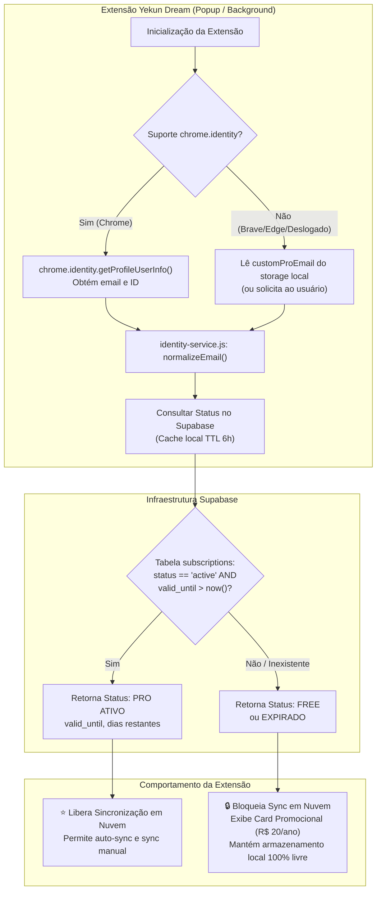

# Especificação de Design: Yekun Cloud PRO — Assinatura Anual (R$ 20/ano) & Identidade Google

- **Data:** 2026-10-14
- **Status:** Proposto (Aguardando Aprovação)
- **Autor:** Antigravity & Sentsuy
- **Tema:** Monetização Freemium, Sincronização em Nuvem Multi-Dispositivo, Licenciamento Anual e Identidade Google

---

## 1. Visão Geral e Objetivos

O **Yekun Dream** é uma extensão de produtividade para rastreamento de mangás e animes, operando primariamente em modelo *local-first* (armazenamento local via `chrome.storage.local` com backup manual em JSON).

Para viabilizar a sustentabilidade financeira, cobrir custos de infraestrutura do Supabase e oferecer uma experiência premium aos usuários avançados, este design especifica a transformação da **Sincronização em Nuvem (Cloud Sync)** em um recurso exclusivo **Yekun Cloud PRO**, com modelo de **Assinatura Anual de R$ 20,00 por ano** e vínculo direto com a **Conta Google** do usuário no navegador (com suporte a fallback por e-mail manual para Brave, Edge, Opera e Firefox).

### 1.1 Metas (Goals)
1. **Zero Fricção de Login:** No Google Chrome, detectar automaticamente a conta Google conectada (`chrome.identity.getProfileUserInfo`), sem necessidade de telas de cadastro ou criação de senhas.
2. **Compatibilidade Multi-Navegador:** Permitir que usuários no Edge, Brave, Opera ou navegadores sem login nativo informem manualmente o mesmo e-mail para validar sua assinatura e sincronizar.
3. **Ativação Instantânea por Código de 4 Dígitos (PIN):** O usuário pode ativar ou resgatar sua assinatura digitando um PIN numérico de 4 dígitos (ex: `7492`), perfeito para confirmação rápida de Pix (você envia o PIN ao comprador e a extensão ativa imediatamente).
4. **Plano Anual Acessível (R$ 20/ano):** Registro de validade de 365 dias por assinatura, com contagem regressiva e aviso suave de renovação.
5. **Proteção no Banco de Dados (Supabase RLS & RPC Segura):** Validação segura no Supabase para impedir que usuários sem plano ativo gravem ou leiam registros da nuvem, e função RPC para validação de PINs sem expor chaves no front-end.
6. **Experiência Visual Clara (FREE vs PRO):** Indicação visual no popup através de selos PRO, estado da assinatura (dias restantes), campo de PIN de 4 dígitos e fluxo intuitivo de ativação.
7. **Integridade Local Preservada:** Usuários gratuitos continuam utilizando todas as funções locais (rastreamento de mangás, auto-tracking de anime a 70%, histórico e backup JSON) sem qualquer bloqueio ou degradação.

### 1.2 Não-Metas (Non-Goals)
- Não será implementado login complexo por senha ou OAuth proprietário dentro da extensão;
- Não será bloqueada nenhuma funcionalidade de gravação local do usuário gratuito.

---

## 2. Arquitetura do Sistema



---

## 3. Modelo de Dados e Banco de Dados (Supabase)

### 3.1 Nova Tabela: `subscriptions`
Armazena as assinaturas ativas e histórico de pagamentos vinculados ao e-mail do usuário.

```sql
CREATE TABLE IF NOT EXISTS subscriptions (
    id UUID PRIMARY KEY DEFAULT gen_random_uuid(),
    email TEXT UNIQUE NOT NULL,
    google_id TEXT,
    plan TEXT NOT NULL DEFAULT 'annual', -- 'annual', 'lifetime'
    status TEXT NOT NULL DEFAULT 'active', -- 'active', 'expired', 'canceled'
    amount_paid NUMERIC(10,2) DEFAULT 20.00,
    valid_until BIGINT NOT NULL,          -- Timestamp em milissegundos (epoch)
    created_at BIGINT NOT NULL DEFAULT (extract(epoch from now()) * 1000)::bigint,
    updated_at BIGINT NOT NULL DEFAULT (extract(epoch from now()) * 1000)::bigint
);

CREATE INDEX IF NOT EXISTS idx_subscriptions_email ON subscriptions(email);
CREATE INDEX IF NOT EXISTS idx_subscriptions_valid_until ON subscriptions(valid_until);
```

### 3.2 Nova Tabela: `activation_pins` (Chaves de 4 Dígitos)
Armazena os PINs de 4 dígitos criados para ativação de assinaturas anuais:

```sql
CREATE TABLE IF NOT EXISTS activation_pins (
    id UUID PRIMARY KEY DEFAULT gen_random_uuid(),
    pin VARCHAR(4) UNIQUE NOT NULL,      -- Código de 4 dígitos (ex: '7492')
    is_redeemed BOOLEAN DEFAULT FALSE,    -- Se já foi resgatado
    redeemed_by_email TEXT,              -- E-mail que ativou o PIN
    redeemed_at BIGINT,                  -- Data do resgate
    valid_duration_days INT DEFAULT 365, -- Duração (padrão: 365 dias)
    created_at BIGINT NOT NULL DEFAULT (extract(epoch from now()) * 1000)::bigint
);

CREATE INDEX IF NOT EXISTS idx_activation_pins_pin ON activation_pins(pin);
```

### 3.3 Função RPC Segura: `redeem_activation_pin(p_pin TEXT, p_email TEXT)`
Para evitar que usuários mal-intencionados consultem a tabela de PINs aberta na API pública, a tabela `activation_pins` não possui SELECT público. O resgate ocorre exclusivamente via função RPC (`SECURITY DEFINER`):

```sql
-- Habilita RLS em activation_pins sem SELECT público
ALTER TABLE activation_pins ENABLE ROW LEVEL SECURITY;

CREATE OR REPLACE FUNCTION redeem_activation_pin(p_pin TEXT, p_email TEXT)
RETURNS JSONB
LANGUAGE plpgsql
SECURITY DEFINER
AS $$
DECLARE
    v_pin_record RECORD;
    v_new_valid_until BIGINT;
    v_now BIGINT;
    v_clean_email TEXT;
BEGIN
    v_now := (extract(epoch from now()) * 1000)::bigint;
    v_clean_email := lower(trim(p_email));

    IF length(p_pin) != 4 THEN
        RETURN jsonb_build_object('success', false, 'error', 'O código deve conter exatamente 4 dígitos.');
    END IF;

    IF v_clean_email IS NULL OR v_clean_email = '' THEN
        RETURN jsonb_build_object('success', false, 'error', 'E-mail do usuário não informado.');
    END IF;

    -- Busca o PIN não utilizado
    SELECT * INTO v_pin_record 
    FROM activation_pins 
    WHERE pin = trim(p_pin) AND is_redeemed = false;

    IF NOT FOUND THEN
        RETURN jsonb_build_object('success', false, 'error', 'Código de 4 dígitos inválido ou já utilizado.');
    END IF;

    -- Calcula nova validade (se já tiver assinatura ativa, adiciona +365 dias; se não, agora + 365 dias)
    SELECT CASE 
        WHEN valid_until > v_now THEN valid_until + (v_pin_record.valid_duration_days::bigint * 86400000)
        ELSE v_now + (v_pin_record.valid_duration_days::bigint * 86400000)
    END INTO v_new_valid_until
    FROM subscriptions
    WHERE email = v_clean_email;

    IF v_new_valid_until IS NULL THEN
        v_new_valid_until := v_now + (v_pin_record.valid_duration_days::bigint * 86400000);
    END IF;

    -- Marca PIN como utilizado
    UPDATE activation_pins
    SET is_redeemed = true,
        redeemed_by_email = v_clean_email,
        redeemed_at = v_now
    WHERE id = v_pin_record.id;

    -- Insere ou atualiza a assinatura do usuário
    INSERT INTO subscriptions (email, plan, status, amount_paid, valid_until, updated_at)
    VALUES (v_clean_email, 'annual', 'active', 20.00, v_new_valid_until, v_now)
    ON CONFLICT (email) DO UPDATE
    SET status = 'active',
        valid_until = v_new_valid_until,
        updated_at = v_now;

    RETURN jsonb_build_object(
        'success', true,
        'message', 'Assinatura Yekun PRO ativada com sucesso!',
        'valid_until', v_new_valid_until,
        'days_added', v_pin_record.valid_duration_days
    );
END;
$$;
```

### 3.4 Tabela de Entradas (`entries`) e Relação com Assinaturas
Cada registro sincronizado na tabela `entries` é indexado pela `sync_key` (vinculada ao e-mail do usuário PRO).

### 3.5 Regras de Segurança (RLS - Row Level Security)
Para garantir que apenas quem pagou consiga sincronizar:

```sql
-- 1. Habilita RLS em subscriptions
ALTER TABLE subscriptions ENABLE ROW LEVEL SECURITY;

-- 2. Permite leitura pública apenas para consulta de status por e-mail específico
CREATE POLICY "Permitir consulta de status por email"
ON subscriptions
FOR SELECT
TO anon
USING (true);

-- 3. Atualização das políticas da tabela entries:
-- Somente permite inserção/atualização/leitura se o sync_key corresponder a uma assinatura ativa
CREATE POLICY "Permitir sync apenas para assinantes ativos"
ON entries
FOR ALL
TO anon
USING (
    EXISTS (
        SELECT 1 FROM subscriptions s
        WHERE s.email = entries.sync_key
          AND s.status = 'active'
          AND s.valid_until > (extract(epoch from now()) * 1000)
    )
)
WITH CHECK (
    EXISTS (
        SELECT 1 FROM subscriptions s
        WHERE s.email = entries.sync_key
          AND s.status = 'active'
          AND s.valid_until > (extract(epoch from now()) * 1000)
    )
);
```

---

## 4. Camada de Identidade: `identity-service.js`

Um novo serviço modular será criado para gerenciar a identidade do usuário de forma limpa:

1. **`getIdentityInfo()`**:
   - Tenta invocar `chrome.identity.getProfileUserInfo()` caso a permissão `"identity"` esteja concedida.
   - Normaliza o e-mail retornado (`email.trim().toLowerCase()`).
   - Se o e-mail do Google for vazio (ex: usuário deslogado ou navegador baseado em Chromium sem conta Google sincronizada), busca a chave `customProEmail` em `StorageLocal.getSettings()`.
2. **`setCustomProEmail(email)`**:
   - Permite que o usuário no Brave/Edge/Firefox insira seu e-mail cadastrado manualmente.
3. **`checkProStatus(forceRefresh = false)`**:
   - Consulta o cache local (`proSubscriptionCache`).
   - Se o cache tiver menos de 6 horas e `forceRefresh` for falso, retorna o status em cache imediatamente.
   - Caso contrário, realiza requisição `GET` para o Supabase:
     ```text
     /rest/v1/subscriptions?email=eq.<email_normalizado>&select=email,status,valid_until,plan
     ```
   - Avalia se `status === 'active'` e `valid_until > Date.now()`.
   - Salva o resultado no storage local para navegação ultrarrápida.

---

## 5. Interface e Experiência do Usuário (UI/UX no Popup)

### 5.1 Na Gaveta de Configurações ⚙️

O bloco de Sincronização em Nuvem será repaginado com foco didático e elegante:

#### Cenário A: Usuário FREE (Não Assinante ou Expirado)
- **Cabeçalho:** `YEKUN CLOUD PRO ⭐` com ícone de cadeado.
- **Card Informativo:**
  - Mostra o e-mail detectado: `👤 Conta detectada: fulano@gmail.com` *(com botão discreto 'Alterar e-mail' para outros navegadores)*.
  - Mensagem explicativa: *"Sincronize seus animes e mangás em tempo real entre o PC, notebook e outros navegadores por apenas R$ 20/ano (menos de R$ 1,70/mês)."*
  - **Campo de Ativação Rápida por PIN de 4 Dígitos:**
    - Input estilizado de 4 dígitos: `[  _  _  _  _  ]` com placeholder `Ex: 7492` e botão `[ Ativar PIN ]`.
    - Ao digitar os 4 dígitos e clicar, chama a RPC `redeem_activation_pin`, valida e ativa na mesma hora!
  - **Botões de Ação:**
    - `[ 💎 Assinar Yekun PRO (R$ 20/ano) ]` (Abre modal com Pix e instruções rápidas).
    - `[ 🔄 Verificar Assinatura / Já Paguei ]`.
  - Os controles de "Sincronização Automática" e o botão "Sincronizar Agora" permanecem desabilitados com tooltip explicativo até a validação.

#### Cenário B: Usuário PRO (Assinatura Ativa)
- **Badge Dourado/Verde:** `[ ⭐ PRO ATIVO ]`.
- **Detalhes da Conta:**
  - `👤 Conta: fulano@gmail.com`
  - `📅 Validade: 14 de Outubro de 2027 (365 dias restantes)`.
- **Campo de Renovação / Adicionar Tempo (Opcional):**
  - Link expansível *"Tenho outro código de 4 dígitos"* para somar mais 365 dias.
- **Controles Liberados:**
  - Toggle de "Sincronização Automática" liberado.
  - Botão "Sincronizar Agora" totalmente operacional.
  - Indicador de última sincronização com sucesso.

### 5.2 Modal de Pagamento / Ativação (Pix)
Ao clicar em "Assinar Yekun PRO (R$ 20/ano)":
- Abre uma gaveta ou modal interno na extensão.
- Apresenta:
  - Valor: **R$ 20,00** (Plano Anual - 1 Ano de Acesso).
  - O QR Code Pix oficial e botão de "Copiar Chave Pix" (já configurados no projeto).
  - Orientações didáticas:
    - *"1. Faça o Pix de R$ 20,00."*
    - *"2. Envie o comprovante ou receba seu código de 4 dígitos."*
    - *"3. Digite os 4 dígitos no campo de ativação e pronto!"*
  - Campo embutido para digitar o PIN de 4 dígitos diretamente dentro do modal e ativar na hora.

---

## 6. Sincronização Segura (`sync-service.js`)

O `sync-service.js` passará a utilizar a identidade do usuário:
- `getClientConfig()` chamará `IdentityService.getIdentityInfo()`.
- O `sync_key` enviado para a nuvem será automaticamente o `email` da conta PRO autenticada.
- Se o usuário não for PRO ativo, o `sync-service.js` abortará a operação com código amigável `{ ok: false, error: 'Recurso exclusivo Yekun PRO. Ative sua assinatura anual para sincronizar.' }`.

---

## 7. Estratégia de Testes Automatizados

Criaremos uma nova suíte de testes `tests/test-pro-cloud-sync.js` cobrindo:
1. **Detecção de Identidade:**
   - Detecção via `chrome.identity` emulada.
   - Fallback para e-mail customizado em navegadores sem `chrome.identity`.
2. **Validação de Status PRO:**
   - Usuário sem assinatura cadastrada -> Retorna `isPro: false`.
   - Usuário com assinatura ativa (`valid_until` no futuro) -> Retorna `isPro: true` e calcula dias restantes.
   - Usuário com assinatura expirada (`valid_until` no passado) -> Retorna `isPro: false` (expirado).
3. **Cache de Licença:**
   - Validação do TTL de 6 horas para evitar requisições desnecessárias.
4. **Guarda no SyncService:**
   - Garantir que `pushPending` e `pullRemote` não realizem chamadas de rede se `isPro: false`.
5. **Atualização da Suíte Geral:**
   - Integrar o novo teste ao `tests/run-all-tests.js` mantendo todas as 46 suítes existentes verdes.

---

## 8. Considerações de Segurança e Privacidade

1. **Privacidade de Dados:** Apenas o e-mail, status da assinatura e os registros de mangás/animes são salvos no banco. Nenhuma informação pessoal sensível ou dados de navegação são coletados.
2. **Abuso e Rate-Limit:** O cache local minimiza chamadas à API do Supabase. A checagem só ocorre na inicialização (a cada 6h) ou quando o usuário clica expressamente em "Verificar Licença" ou "Sincronizar".
3. **Resiliência Offline:** Se o usuário estiver sem internet, a extensão utiliza o último estado de assinatura verificado, permitindo que continue lendo e marcando suas obras localmente sem bloqueios.
