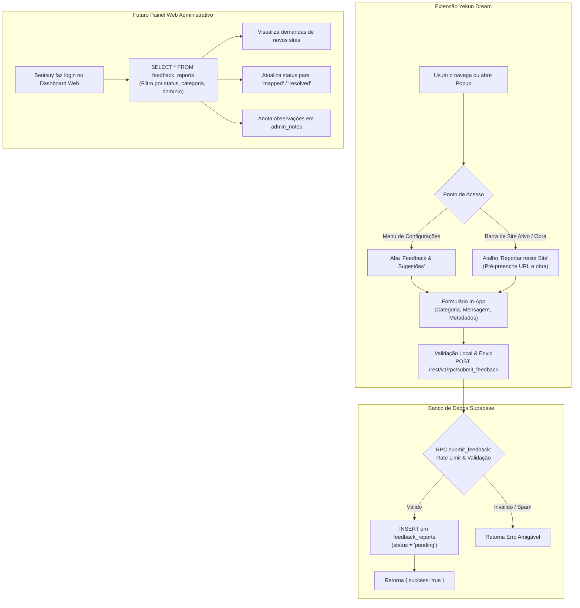

# Especificação de Design: Central de Feedback, Sugestões e Mapeamento de Sites (Feed In-App)

- **Data:** 16 de Outubro de 2026
- **Status:** Proposto (Aguardando Aprovação do Usuário)
- **Autor:** Antigravity & Sentsuy
- **Tema:** Comunicação Bidirecional Usuário-Desenvolvedor, Sugestões de Mapeamento de Sites, Relato de Erros e Base para Painel Web de Gestão

---

## 1. Visão Geral e Objetivos

O **Yekun Dream** monitora centenas de leitores de mangás, scans e plataformas de streaming de animes. Dada a dinâmica constante da web (sites mudam de domínio, alteram seletores de player ou novos agregadores surgem), é essencial que os próprios usuários possam facilmente:
1. **Sugerir novos sites** para você mapear na extensão.
2. **Reportar falhas pontuais** (ex: título capturado incorretamente, episódio que não marcou aos 70%).
3. **Enviar sugestões ou elogios gerais** sobre o aplicativo.

Tudo isso diretamente de dentro da extensão, com armazenamento centralizado e seguro no **Supabase**, preparado para consulta e triagem posterior através de uma **Interface Web Administrativa**.

### 1.1 Metas (Goals)
1. **Envio Sem Fricção In-App:** O usuário envia sugestões ou relatos diretamente pelo popup da extensão sem precisar abrir e-mail, criar conta no GitHub ou sair da navegação.
2. **Dois Pontos de Acesso Intuitivos:**
   - **Central Geral:** Aba/seção dedicada em *Configurações ⚙️ → Feedback & Sugestões*.
   - **Atalho Contextual Rápido:** Botão discreto ("Reportar falha neste site" / "Sugerir mapeamento") presente na barra de contexto do site ativo, já pré-preenchendo a URL e os dados da página.
3. **3 Categorias Claras:**
   - `site_mapping`: Sugerir novo site ou scan para ser suportado.
   - `bug_report`: Relatar erro na captura da obra, capítulo ou player de vídeo.
   - `suggestion`: Sugestão de funcionalidade, crítica ou comentário geral.
4. **Captura Automática de Telemetria Técnica Não-Sensível:** Anexar automaticamente URL da página, domínio, título e capítulo detectados, versão da extensão e navegador, facilitando a depuração imediata.
5. **Segurança e Anti-Spam no Banco:**
   - Função RPC segura (`SECURITY DEFINER`) com validação de tamanho de texto e rate-limiting (máx. 5 envios por hora por identificador/IP).
   - RLS estrito: usuários comuns **não** podem ler os relatos de outros usuários via API pública; leitura restrita ao administrador.
6. **Preparação para Dashboard Web:** O esquema relacional no Supabase já nasce com campos de controle de fluxo (`status`: `pending`, `in_review`, `mapped`, `resolved`, `rejected`) e `admin_notes`.

---

## 2. Arquitetura do Sistema



---

## 3. Modelo de Dados no Supabase

### 3.1 Tabela `feedback_reports`
Armazena todos os envios de usuários com limites estritos de tamanho de coluna para evitar abusos ("espertões") e injeção de grandes volumes de texto:

```sql
CREATE TABLE IF NOT EXISTS feedback_reports (
    id                  UUID PRIMARY KEY DEFAULT gen_random_uuid(),
    category            VARCHAR(20) NOT NULL CHECK (category IN ('site_mapping', 'bug_report', 'suggestion')),
    message             VARCHAR(300) NOT NULL,  -- Limite simples e direto de 300 caracteres
    site_url            VARCHAR(300),           -- URL sanitizada
    domain              VARCHAR(100),           -- Ex: 'mangaschan.com', 'animesonline.cc'
    detected_title      VARCHAR(200),           -- Título capturado (truncado em 200)
    detected_chapter    VARCHAR(50),            -- Capítulo/episódio detectado (máx 50)
    user_email          VARCHAR(150),           -- E-mail opcional para contato (máx 150)
    extension_version   VARCHAR(20) NOT NULL,   -- Ex: '1.2.0'
    browser_info        VARCHAR(150),           -- Ex: 'Chrome 128 / Linux'
    status              VARCHAR(20) NOT NULL DEFAULT 'pending' 
                        CHECK (status IN ('pending', 'in_review', 'mapped', 'resolved', 'rejected')),
    admin_notes         VARCHAR(2000),          -- Anotações internas do desenvolvedor no painel
    created_at          BIGINT NOT NULL DEFAULT (extract(epoch from now()) * 1000)::bigint,
    updated_at          BIGINT NOT NULL DEFAULT (extract(epoch from now()) * 1000)::bigint
);

-- Índices para performance e consultas no futuro painel web
CREATE INDEX IF NOT EXISTS idx_feedback_reports_status ON feedback_reports(status);
CREATE INDEX IF NOT EXISTS idx_feedback_reports_category ON feedback_reports(category);
CREATE INDEX IF NOT EXISTS idx_feedback_reports_domain ON feedback_reports(domain);
CREATE INDEX IF NOT EXISTS idx_feedback_reports_created_at ON feedback_reports(created_at DESC);
```

### 3.2 Tabela de Rate Limiting `feedback_rate_limits`
Evita flood na API pública (máx. 5 envios por hora).

```sql
CREATE TABLE IF NOT EXISTS feedback_rate_limits (
    id UUID PRIMARY KEY DEFAULT gen_random_uuid(),
    identifier VARCHAR(150) NOT NULL,             -- IP ou e-mail normalizado
    submitted_at BIGINT NOT NULL
);

CREATE INDEX IF NOT EXISTS idx_feedback_rate_limits_id_time 
    ON feedback_rate_limits(identifier, submitted_at);
```

### 3.3 RPC Segura com Validação e Truncamento Duplo: `submit_feedback(...)`

```sql
CREATE OR REPLACE FUNCTION submit_feedback(
    p_category          TEXT,
    p_message           TEXT,
    p_site_url          TEXT    DEFAULT NULL,
    p_detected_title    TEXT    DEFAULT NULL,
    p_detected_chapter  TEXT    DEFAULT NULL,
    p_user_email        TEXT    DEFAULT NULL,
    p_extension_version TEXT    DEFAULT '1.2.0',
    p_browser_info      TEXT    DEFAULT NULL
)
RETURNS JSONB
LANGUAGE plpgsql
SECURITY DEFINER
AS $$
DECLARE
    v_clean_cat     VARCHAR(20);
    v_clean_msg     VARCHAR(300);
    v_clean_url     VARCHAR(300);
    v_domain        VARCHAR(100);
    v_title         VARCHAR(200);
    v_chapter       VARCHAR(50);
    v_clean_email   VARCHAR(150);
    v_version       VARCHAR(20);
    v_browser       VARCHAR(150);
    v_now           BIGINT;
    v_recent_count  INT;
    v_identifier    VARCHAR(150);
    v_report_id     UUID;
BEGIN
    v_now := (extract(epoch from now()) * 1000)::bigint;
    v_clean_cat := lower(trim(coalesce(p_category, '')));
    
    -- Validação de categoria
    IF v_clean_cat NOT IN ('site_mapping', 'bug_report', 'suggestion') THEN
        RETURN jsonb_build_object('success', false, 'error', 'Categoria inválida.');
    END IF;

    -- Validação e truncamento estrito de mensagem (mínimo 5, máximo 300 chars)
    IF length(trim(coalesce(p_message, ''))) < 5 THEN
        RETURN jsonb_build_object('success', false, 'error', 'Mensagem muito curta (mínimo 5 caracteres).');
    END IF;
    IF length(p_message) > 300 THEN
        RETURN jsonb_build_object('success', false, 'error', 'Mensagem excede o limite permitido de 300 caracteres.');
    END IF;
    v_clean_msg := substr(trim(p_message), 1, 300);

    -- Sanitização e limites de campos secundários contra payloads inflados
    v_clean_url := substr(trim(coalesce(p_site_url, '')), 1, 300);
    v_title := substr(trim(coalesce(p_detected_title, '')), 1, 200);
    v_chapter := substr(trim(coalesce(p_detected_chapter, '')), 1, 50);
    v_clean_email := substr(lower(trim(coalesce(p_user_email, ''))), 1, 150);
    v_version := substr(trim(coalesce(p_extension_version, '1.2.0')), 1, 20);
    v_browser := substr(trim(coalesce(p_browser_info, '')), 1, 150);

    -- Extração e sanitização do domínio
    IF v_clean_url != '' THEN
        v_domain := substr(lower(substring(v_clean_url from '^(?:https?:\/\/)?(?:www\.)?([^\/\?#]+)')), 1, 100);
    END IF;

    -- Identificador para rate limit (máx 5 envios por hora)
    v_identifier := CASE 
        WHEN v_clean_email != '' THEN v_clean_email 
        ELSE 'anon_session' 
    END;

    SELECT count(*) INTO v_recent_count
    FROM   feedback_rate_limits
    WHERE  identifier = v_identifier
      AND  submitted_at > (v_now - 3600000);

    IF v_recent_count >= 5 THEN
        RETURN jsonb_build_object(
            'success', false,
            'error',   'Limite de envios atingido (máx. 5 por hora). Aguarde antes de enviar novamente.'
        );
    END IF;

    INSERT INTO feedback_rate_limits (identifier, submitted_at)
    VALUES (v_identifier, v_now);

    -- Gravação com tipos e tamanhos estritos
    INSERT INTO feedback_reports (
        category, message, site_url, domain, detected_title,
        detected_chapter, user_email, extension_version, browser_info,
        status, created_at, updated_at
    )
    VALUES (
        v_clean_cat, v_clean_msg, NULLIF(v_clean_url, ''), NULLIF(v_domain, ''),
        NULLIF(v_title, ''), NULLIF(v_chapter, ''), NULLIF(v_clean_email, ''),
        v_version, NULLIF(v_browser, ''),
        'pending', v_now, v_now
    )
    RETURNING id INTO v_report_id;

    RETURN jsonb_build_object(
        'success',   true,
        'report_id', v_report_id,
        'message',   'Feedback recebido com sucesso! Obrigado pela colaboração.'
    );
END;
$$;

-- RLS: Segurança máxima para proteção dos dados
ALTER TABLE feedback_reports ENABLE ROW LEVEL SECURITY;
ALTER TABLE feedback_rate_limits ENABLE ROW LEVEL SECURITY;

-- Usuários anônimos da extensão não possuem permissão de SELECT direto na tabela.
-- Apenas podem submeter através da RPC submit_feedback.
GRANT EXECUTE ON FUNCTION submit_feedback(TEXT, TEXT, TEXT, TEXT, TEXT, TEXT, TEXT, TEXT) TO anon;
```

---

## 4. Design da Interface do Usuário (Extensão)

### 4.1 Seção Geral no Menu de Configurações (`popup.html` / `popup.css`)
No drawer de configurações (ou como nova gaveta colapsável "💡 Feedback & Sugestões"):
* **Seletores de Categoria (Pills / Radios Estilizados):**
  - 🌐 *Sugerir Site*: Ícone de globo (ideal quando um site não é suportado).
  - 🐞 *Reportar Erro*: Ícone de bug (captura falhou, capítulo errado).
  - 💬 *Sugestão / Crítica*: Ícone de balão de texto.
* **Badge do Contexto Ativo (Informativo e Opcional):**
  - Mostra: *"Página atual: mangaschan.com (Capítulo 42)"* com checkbox marcado: `[x] Incluir detalhes da página atual`.
* **Área de Texto da Mensagem:**
  - `textarea` com placeholder contextual baseado na categoria selecionada:
    - *Site*: *"Cole o link do mangá/anime que você tentou ler e nos conte o que aconteceu..."*
    - *Bug*: *"O que deu errado? Ex: O nome da obra apareceu cortado ou o capítulo não avançou..."*
    - *Sugestão*: *"Tem uma ideia de funcionalidade ou melhoria? Conte pra gente..."*
  - Contador visual: `0 / 2000`.
* **E-mail de Contato (Opcional):**
  - Pré-preenchido automaticamente com a conta Google do usuário ou seu e-mail configurado.
* **Botão de Envio:**
  - *"Enviar Feedback"* com animação de carregamento e confirmação visual de sucesso.

### 4.2 Atalho Contextual Rápido
* Na barra superior de status do site ativo (onde hoje aparece o botão de ativar/desativar botão flutuante):
  - Um pequeno botão com ícone ⚠️ / 💬 *"Reportar problema"*.
  - Ao clicar, abre o modal/gaveta de feedback com a categoria `bug_report` ou `site_mapping` já selecionada e a URL atual já preenchida.

---

## 5. Arquitetura para a Futura Interface Web Administrativa

Como as mensagens serão gravadas com estrutura normalizada e enriquecida, seu futuro painel web precisará apenas:
1. Conectar ao Supabase via `@supabase/supabase-js` com sua credencial de administrador.
2. Exibir uma lista de chamados com filtros rápidos:
   - **Por Status:** Todos | Pendentes (laranja) | Em Análise (azul) | Mapeados/Resolvidos (verde).
   - **Por Categoria:** Mapeamento de Site | Bug | Sugestão.
   - **Agrupamento por Domínio:** Quantos usuários pediram o site `x`, `y` ou `z` (útil para priorizar quais sites mapear primeiro com base no número de pedidos!).
3. Campo de texto para você inserir anotações internas (`admin_notes`).
4. Botão de alternar status (`Marcar como Mapeado`).

---

## 6. Próximos Passos & Plano de Implementação

1. **Aprovação deste Design**: Você avalia este escopo e sugere qualquer ajuste.
2. **Criação do Script SQL no Supabase**: `scripts/supabase-feedback-setup.sql` com tabelas, RLS e a RPC `submit_feedback`.
3. **Implementação da UI no Popup**: Formulário elegante no estilo Cyber Dark/Neon em `popup.html`, `popup.css` e `popup.js`.
4. **Serviço de Envio de Feedback**: Função limpa em `identity-service.js` ou serviço dedicado `feedback-service.js`.
5. **Suíte de Testes Automatizados**: Teste de validação das RPCs, limites de tamanho e sanitização.
